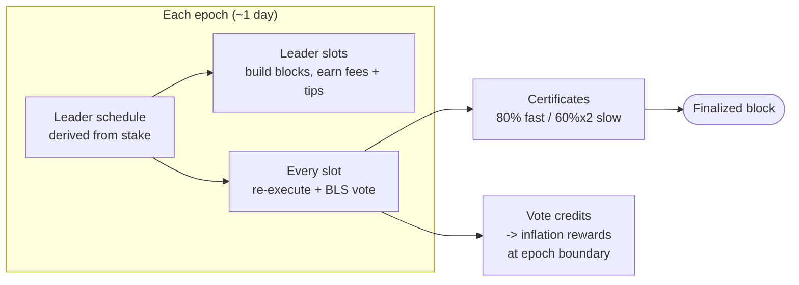
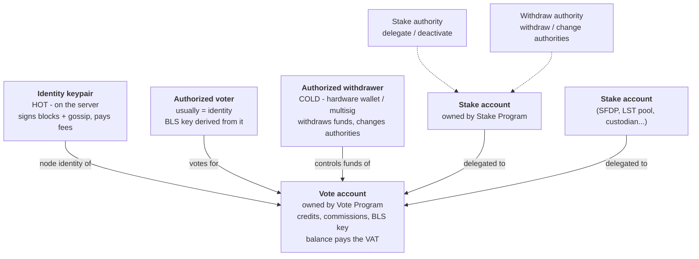

# Module 12: Validators on Solana

## Learning Objectives

By the end of this module, participants will be able to:

- Explain what a validator does on Solana after Alpenglow: leading slots, building blocks, and voting stake-weighted on finality
- Distinguish consensus validators, RPC nodes, and Geyser/indexing nodes, and decide which one an enterprise actually needs
- Describe the validator client landscape (Agave, Jito-Agave, Firedancer) and why client diversity matters
- Map the validator account model: identity, vote account, authorized voter/withdrawer, BLS key, and stake accounts with their authorities
- Model validator economics: inflation rewards, commissions, block fees, MEV tips, the Validator Admission Ticket (VAT), and hardware costs
- Compare staking options for an enterprise treasury: native staking, LSTs, custodial staking, and running your own validator
- Explain how the Solana Foundation Delegation Program (SFDP) works, how it changed in November 2026, and why
- Make a build-vs-buy decision for validator and RPC infrastructure, and outline the operational practices that matter: key management, monitoring, upgrades, and failover

## Topics Covered

- What a validator does
- Node types: validator, RPC, Geyser
- Validator clients and client diversity
- The validator account model
- Validator economics
- Staking for enterprises
- The Solana Foundation Delegation Program (SFDP) and its November 2026 changes
- Run your own vs. use a provider
- Operations overview

## Prerequisite

[Module 1: Solana Overview](../module-1-solana-overview/), especially section 3 (architecture and Alpenglow consensus). [Module 9](../module-9-indexing-on-solana/) is useful background for the RPC/Geyser discussion.

## Slides

[Validators on Solana slides - PLACEHOLDER]

## Hands-on lab

| Lab | What you do | Needs |
|---|---|---|
| [Local test validator](examples/local-test-validator/) | Start a one-node cluster, find the identity/vote/stake keys on disk, inspect it like an operator, clone mainnet state, warp time | Solana CLI |
| [Staking kit](examples/staking-kit/) | TypeScript scripts: inspect the validator set, create and delegate a stake account, read rewards, deactivate and withdraw | Node.js + a local validator or devnet |
| [Testnet validator runbook](examples/testnet-validator-runbook.md) | Bring up a real Agave validator on testnet: hardware, OS tuning, keys, vote account, BLS registration, systemd, monitoring, failover | A bare-metal server |

---

> [!NOTE]
> **Figures in this module are a snapshot as of November 2026.** Validator counts, client shares, inflation, and the VAT change frequently. Each figure links to its source, so instructors should re-check them before teaching.

## 1. What a Validator Does

A validator is a server running Solana client software that keeps a full copy of the current state, executes every block, and takes part in consensus with the stake delegated to it. Module 1 covered the protocol. This module is about the **machine and the business** behind it.

Each validator plays two roles:

**Leader (block producer).** The leader schedule for each epoch is computed in advance from stake weights, so a validator with 1% of stake leads roughly 1% of slots. During its slots the validator receives transactions directly from clients and RPC nodes (Gulf Stream, over QUIC), orders and executes them with Sealevel, and sends the block out through Turbine. Mainnet now runs **200ms slots** (SIMD-0525), so an epoch of 432,000 slots lasts about one day.

**Voter.** In every slot, whether or not it is leading, a validator re-executes the leader's block and votes on it. Since Alpenglow (Votor), votes are **BLS-signed messages sent directly between validators**, not on-chain transactions. They are aggregated into certificates: 80% of stake finalizes a block in one round, or 60% over two rounds.

Everything about a validator scales with **stake**: how often it leads (fee revenue), how much its vote weighs, and how much inflation it earns for its delegators.



> [!NOTE]
> **What changed for operators with Alpenglow** (mainnet epoch 1064, Oct 21 2026). Vote transactions used to make up most of the transactions on chain and cost each validator around 1.1 SOL a day in fees. They are gone. In their place every validator pays a flat **Validator Admission Ticket** per epoch (section 5), must register a **BLS public key** on its vote account, and only the **top 2,000 validators by stake** are admitted to consensus each epoch. Sources: [Solana BLS/VAT upgrade page](https://solana.com/upgrades/bls-pubkey-vat), [Solana Compass](https://solanacompass.com/news/solana-alpenglow-is-live-on-mainnet-as-anza-retires-towerbft-at-slot-459653000).

### The network today

| Metric | Value (Nov 2026) | Source |
|---|---|---|
| Staked validators | ~650-660 | [Solana Compass](https://solanacompass.com/statistics/decentralization) |
| Total nodes in gossip (incl. RPC) | ~3,700 | same |
| Nakamoto coefficient | ~18 | same |
| Share of supply staked | ~67% | [Solana Compass tokenomics](https://solanacompass.com/tokenomics) |

The validator count has fallen from a peak of about 2,560 in 2023. Small operators leave once their delegation subsidies taper off and fixed costs stay the same, which is why the economics in section 5 matter for decentralization as well as for operators.

## 2. Node Types: Which One Do You Actually Need?

All three run the same client software with different flags. The difference is what they are for.

| | Consensus validator | RPC node | Geyser / indexing node |
|---|---|---|---|
| Votes and leads slots | Yes | No (`--no-voting`) | No |
| Needs stake | Yes, to matter | No | No |
| Serves your app's reads and `sendTransaction` | Should not (keep RPC private) | **Yes, its whole job** | Streams data out |
| Typical enterprise need | Treasury yield, ecosystem role, brand | **Almost always** | Indexing, analytics, real-time feeds (Module 9) |
| Hardware | 12+ cores, 256 GB+ RAM, 3 NVMe, 10 Gbps | Heavier: 16+ cores, 512 GB RAM with indexes | RPC node + plugin |
| Pays VAT | Yes | No | No |

**The usual enterprise path:** start with a commercial RPC provider (Helius, Triton, QuickNode, Alchemy, and others), move to **dedicated** RPC nodes from a provider when you need isolation and guaranteed throughput, and only then consider running your own RPC. Running a consensus validator is a separate decision, driven by staking strategy and ecosystem participation, not by your app's infrastructure needs.

> [!TIP]
> **Transaction landing.** Validators prioritize traffic from staked peers (stake-weighted QoS). An unstaked RPC node competes for leader bandwidth with everyone else. Providers that operate staked validators route your transactions over those staked connections. This, more than raw RPC capacity, is often what decides payment-landing reliability (Module 7).

## 3. Validator Clients and Client Diversity

A **client** is an independent implementation of the Solana validator. If a bug in one client could halt or fork the network, a second client with different code is the defence.

| Client | Built by | Language | Status (Nov 2026) |
|---|---|---|---|
| **Agave** | Anza | Rust | Reference client. Stable v4.4.x on mainnet, v4.5 beta on testnet ([releases](https://github.com/anza-xyz/agave/releases)) |
| **Jito-Agave (Jito-Solana)** | Jito Labs | Rust (Agave fork) | Agave plus the Jito block engine / MEV integration. Runs a large share of stake |
| **Harmonic / other Agave forks** | Various | Rust | Alternative block-building forks of Agave |
| **Firedancer** | Jump Crypto | C | Independent rewrite. Live on mainnet since Dec 2025, Alpenglow support from v26.10.x, roughly 15-17% of stake after the switch |
| ~~Frankendancer~~ | Jump | C + Rust | Hybrid (Firedancer networking, Agave runtime). **Retired**: it cannot run Alpenglow |

About 83% of stake still runs Agave-family code, so most of the network shares one codebase. A severe Agave bug is still a network-level risk. Firedancer growing past 33% of stake would mean no single client could halt finality by itself. Sources: [Firedancer adoption](https://uwuu.ai/blog/solana-firedancer), [Frankendancer end of support](https://cryptobriefing.com/jump-firedancer-ends-frankendancer-support/).

**For an enterprise:** if you run validators, client choice is a risk-management decision. It belongs in your vendor review, and the SFDP sets minimum versions per client. If you delegate, prefer operators that run, or are moving to, a minority client.

## 4. The Validator Account Model

A validator is held together by a handful of on-chain accounts and keys. Getting their custody right matters more than any other security decision an operator makes.



**Validator side**

| Key / account | What it controls | Custody |
|---|---|---|
| **Identity** | Signs blocks and gossip messages; pays the node's fees | Must be on the server (hot). Keep its balance small |
| **Vote account** | On-chain record of the validator: credits earned, commission settings, collectors, BLS key. Receives commission. **Pays the VAT** | An address, not a key you need to keep after creation |
| **Authorized voter** | Signs votes. Its derived BLS key signs Alpenglow votes | Usually the identity |
| **Authorized withdrawer** | Withdraws from the vote account and can change any authority. **Whoever holds it owns the validator's income** | **Cold.** Hardware wallet, multisig (e.g. Squads), or HSM. Never on the server |

Vote accounts now have **two separate commissions**: on inflation rewards and on block revenue (fees). Each has its own collector address and is set in basis points (`--inflation-rewards-commission-bps`, `--block-revenue-commission-bps`). You can see all of this on a local validator in the [local lab](examples/local-test-validator/), step 2.

**Delegator side**

A **stake account** is a separate account owned by the Stake Program, with two authorities:

- **Stake authority:** can delegate, redelegate, deactivate, split, and merge
- **Withdraw authority:** can withdraw lamports and change both authorities. It can also hold a **lockup** (time- or epoch-based) that blocks withdrawals until a date. Vesting schedules and some custodial products use this

The validator has no authority over a delegator's stake account. It can earn on the stake but cannot move it.

**Lifecycle:** `delegate` → *activating* → **active** at the next epoch boundary → `deactivate` → *deactivating* → **inactive** at the next boundary → `withdraw`. Changes across the whole network are rate-limited to **9% of effective stake per epoch**. When less than that is moving, which is the normal case, a delegation activates in one epoch. When a lot moves at once, for example a large LST unwinding, it can take several. Try the whole cycle in the [staking kit](examples/staking-kit/).

## 5. Validator Economics

### Where the money comes from

| Revenue | Paid to | Validator's share | Notes |
|---|---|---|---|
| **Inflation rewards** | Stake accounts, per epoch | Inflation commission (commonly 0-10%) | Proportional to stake × vote credits earned. Current inflation ≈ **3.5%** a year |
| **Base fees** | Leader | 50% (other 50% burned) | 5,000 lamports per signature |
| **Priority fees** | Leader | 100% ([SIMD-0096](https://thedefiant.io/solana-proposal-to-pay-full-priority-fees-to-validators-goes-live)) | Can be shared with delegators through block-revenue commission settings |
| **MEV tips (Jito)** | Tip accounts, distributed per epoch | Validator's MEV commission | Block engine fee 3% + TipRouter 3% come off the top ([Jito](https://www.jito.network/blog/what-is-jito-tiprouter/)) |

**Inflation schedule:** started at 8% a year, falls 15% a year, and has a 1.5% floor. [SIMD-0550](https://solanacompass.com/news/simd-0607-must-merge-before-solanas-disinflation-rate-can-activate-anza-says) (passed Aug 2026) will double the disinflation rate to 30% a year once its feature gate activates. **Staking yield** for delegators is about 5-6% a year after commission, including MEV ([21Shares](https://21shares.com/en-us/insights/solana-simd-550-simd-553-staking-yield)). It falls as inflation declines.

### Where the money goes

| Cost | Typical magnitude | Notes |
|---|---|---|
| **Validator Admission Ticket (VAT)** | **0.8 SOL per epoch** (≈ 0.8 SOL/day ≈ 290 SOL/year) | Deducted from the vote account and **burned** at the start of each epoch to admit the validator to the next one. Set by SIMD-0357, scaled by SIMD-0525. A proposal to halve it is under discussion ([Solana Compass](https://solanacompass.com/news/solana-validator-operator-asks-to-halve-the-validator-admission-ticket-to-04-sol-as-sfdp-support-shrinks)) |
| Server (bare metal) | Roughly $1,000-2,000 per month per node | Plus a hot spare if you want failover |
| Bandwidth | Can exceed server cost | 10 Gbps unmetered recommended |
| People | 24/7 on-call | Usually the biggest real cost for an enterprise |

### Break-even framework

```
commission revenue per epoch
  = delegated stake × per-epoch inflation yield × inflation commission
  + leader slots × avg block revenue × block-revenue share
  + MEV tips × MEV commission

profit per epoch = commission revenue − VAT − (hardware + bandwidth + people) / epochs per year
```

With the VAT alone, operators estimate break-even at roughly **40,000-110,000 SOL of delegated stake**, depending on commission and assumptions ([Solana Compass, Nov 2026](https://solanacompass.com/news/solana-validator-operator-asks-to-halve-the-validator-admission-ticket-to-04-sol-as-sfdp-support-shrinks)). Hardware and staff push that higher. **The takeaway for an enterprise:** a validator only pays for itself on commission if you control or attract a lot of stake, usually your own treasury. Otherwise run it as a strategic or ecosystem investment, not a profit centre.

> [!IMPORTANT]
> **Slashing is not live on Solana mainnet.** A delegator's principal is not at risk from validator misbehaviour today. The risk is *lost rewards*: a delinquent validator earns nothing while it's down. Under Alpenglow a double vote is provable on-chain (SIMD-0326), and slashing is planned, with no mechanics or date announced. Due diligence on operators will matter more once it arrives.

## 6. Staking for Enterprises

A company holding SOL on its balance sheet has four ways to earn the staking yield:

| Option | Yield | Liquidity | Control / custody | Operational burden | Fits |
|---|---|---|---|---|---|
| **Native delegation** to a third-party validator | Full, minus validator commission | About 1 epoch to unstake | You keep the withdraw key | Low: choose and monitor validators | Treasury with a long horizon and its own key infrastructure |
| **Liquid staking token** (JitoSOL, mSOL, bSOL, ...) | Yield minus the pool fee | **Instant** via DEX swap (Module 6) | Smart contract risk on the pool | Very low | Treasury that needs liquidity or wants to use DeFi with staked SOL |
| **Custodial / institutional staking** (Coinbase, Anchorage, BitGo, Figment, ...) | Yield minus custodian fee | Custodian's terms | Custodian holds keys (regulated) | Lowest | Regulated entities, auditors who want a qualified custodian |
| **Run your own validator** and self-delegate | Full yield plus commission from others, minus all costs | About 1 epoch | Full | **High** (section 9) | Large holders, ecosystem players, infrastructure companies |

**Choosing a validator: due-diligence checklist**

- **Performance:** uptime / delinquency history, skip rate vs. cluster average, vote credits ([validators.app](https://www.validators.app), [stakewiz](https://stakewiz.com))
- **Commission:** inflation, block-revenue, and MEV commissions, and how often they change (watch for "commission rugs": raising commission just before an epoch boundary)
- **Decentralization:** avoid the superminority (the top validators holding >1/3 of stake) and over-concentrated data centers or ASNs. `npm run inspect-validators` in the staking kit computes the superminority
- **Client:** minority client (Firedancer) earns extra credit for network resilience
- **Counterparty:** who operates it, what jurisdiction, SOC 2 or an equivalent, insurance, and whether a known entity stands behind it
- **Diversify:** split large positions across several validators. Stake accounts can be split and redelegated

**Solana Foundation Delegation Program (SFDP).** The Foundation also delegates stake to independent validators. Section 7 covers how it works and why it changed in November 2026.

## 7. The Solana Foundation Delegation Program (SFDP)

The SFDP is how the Solana Foundation lends part of its own SOL stake to independent validators. It has shaped the validator set more than any other single policy: in August 2024, 1,105 of the network's 1,525 validators (72%) were SFDP members ([Helius](https://www.helius.dev/blog/solana-foundation-delegation-program-sfdp)). Anyone planning to run a validator, or choosing one to delegate to, needs to understand how it works and why it has just changed.

As of November 2026 the program delegates about **23.7M SOL to roughly 330 validators**, about **5% of all staked SOL** ([Foundation dashboard via Solana Compass](https://solanacompass.com/news/solana-foundation-puts-a-12-month-limit-and-300000-sol-exit-on-its-validator-delegation-program)).

### How it works

The program's stated goals are a more decentralized, reliable network, more validators funded by a broad range of stakers, and a large, representative **testnet** where new releases are proven ([solana.org/delegation-program](https://solana.org/delegation-program)).

**The path in.** An applicant passes KYC, runs a **testnet** validator first, and must meet the testnet performance baseline in at least 5 of the last 10 epochs before mainnet delegation starts. Operators must run their own validator: hosting at a provider is fine, white-label or managed validator services are not.

**How much stake.** Delegation has two parts:

| Component | Rule (Nov 2026) | Purpose |
|---|---|---|
| **Residual delegation** | Flat **5,000 SOL** per eligible validator | Gets a new validator onto the leader schedule |
| **Matching** | **0.5 SOL for every 1 SOL of outside stake**, up to **50,000 SOL** of matched stake | Rewards operators who attract their own delegators |
| **Vote cost coverage** | 100% → 75% → 50% → 25% of vote costs over four quarters, then nothing. First validator per entity only | Softens the fixed cost of the first year |

A validator with 40,000 SOL from outside delegators gets 20,000 SOL matched plus the 5,000 SOL residual: 25,000 SOL from the Foundation, 65,000 SOL in total. Matching stops growing at 100,000 SOL of outside stake.

**Ongoing criteria** ([solana.org/delegation-criteria](https://solana.org/delegation-criteria)):

- Commission **≤ 5%** and Jito MEV commission **≤ 10%**
- Skip rate no worse than the cluster average + 5 percentage points
- Minimum client versions (Agave 4.4.0+ or Firedancer 26.10.6+; no Frankendancer), raised shortly after each supermajority upgrade
- Concentration limits: the validator's data center may hold at most **15%** of network stake and its ASN / hosting company at most **25%** (since May 2026)
- Fair transaction ordering, no private mempools or sandwiching (members were removed for this in June 2024), and timely response to critical network events

### How the program has evolved

| When | Change |
|---|---|
| **2020** | Launched with a 100M SOL pool. Foundation stake was **44%** of all staked SOL, spread widely to bootstrap the validator set |
| **Dec 2023 → Apr 2024** | Redesign: 1:1 matching of outside stake up to 100k SOL, vote-cost coverage tapering over 12 months, hard cutoff for validators with large outside stake |
| **Aug 2024** | 72% of validators were SFDP members, but 51% of members had attracted less than 1,000 SOL of outside stake. Helius estimated about 900 would be unprofitable without the program |
| **Apr 2025** | "One in, three out": for every new validator added, three long-standing members with under 1,000 SOL of outside stake are removed ([Decrypt](https://decrypt.co/316097/solana-foundation-shifts-validator-strategy)) |
| **Oct 2025** | Matching cut from 1:1 up to 100k SOL to 0.5:1 up to 50k SOL |
| **2026** | Residual set at 5,000 SOL, commission cap 5%, data-center and ASN limits, Firedancer in and Frankendancer out. Foundation stake down to about **5%** of staked SOL |
| **Nov 6, 2026** | Time-limited membership and a size cap (below) |

Each step put more weight on **outside stake, performance and self-sufficiency**. The program went from being the network's main source of stake, to an incubator that matches outside stake, to a short, time-limited launchpad.

### The November 2026 changes

Effective **November 6, 2026** ([solana.org/faq](https://solana.org/faq), [Solana Compass](https://solanacompass.com/news/solana-foundation-puts-a-12-month-limit-and-300000-sol-exit-on-its-validator-delegation-program)):

- **12-month membership.** Counted from a validator's first eligible mainnet epoch. After that it "retires" from the program. The Foundation stresses this is not a penalty: the validator keeps running and looks for stake elsewhere, and can apply for renewal.
- **Graduation at 300,000 SOL of outside stake.** Validators that attract this much outside stake leave the program. (The criteria page still shows an older 1,000,000 SOL figure; the FAQ and the announcement use 300,000.)
- **A cap of 100 validators** in the program at any one time. With about 330 members today, roughly 230 will leave unless their renewal is approved.
- **Must operate your own validator.** No white-label or managed services.
- **Transition.** Existing members who exceed the new limits are being retired in **weekly batches**. Members can apply to stay by documenting their contributions to the ecosystem; more than 100 had applied by mid-November.
- **A separate track for contributors.** Validators that do significant work for network health (client development, testing, tooling) can receive **discretionary Foundation stake outside the SFDP**, as early Frankendancer operators did.

### Why the Foundation made these changes

The Foundation's reasoning, from its announcement and from statements by Jacob Creech of the Solana Foundation ([Solana Compass](https://solanacompass.com/news/solana-foundations-jacob-creech-says-sfdp-has-done-its-job-as-validator-removals-go-ahead)):

1. **The program has done its job.** It was built to bootstrap new validators, keep testnet healthy, and get early testing of protocol changes. With a mature validator set and Alpenglow shipped, the Foundation sees the bootstrapping phase as complete.
2. **A launchpad, not a permanent home.** Since 2023 the Foundation has said it wants self-sustaining validators. Data like "51% of members have under 1,000 SOL of outside stake" showed a large group of validators that existed only because of Foundation stake. The April 2025 policy openly targeted these "validators in name only."
3. **Reward contribution, not just uptime.** The Foundation said the old criteria were too thin and too slow to adapt for a network that changes quickly. Discretionary stake lets it back operators who do real work for the network, such as the community cluster that tested Alpenglow, instead of anyone who meets a checklist.
4. **The Foundation's stake is no longer the main lever.** Foundation stake fell from 44% of staked SOL in 2020 to about 5% today. Decentralization now depends far more on stake pools, LSTs and institutional delegators than on the SFDP.

The Foundation says cutting validator numbers is not the goal, though it may happen, and that the rules will be applied gradually.

### Context and criticism

**The cost of running a small validator went up in relative terms.** Under Alpenglow every validator pays a flat **Validator Admission Ticket** of 0.8 SOL per epoch (about 290 SOL a year) whatever its stake (section 5). A flat cost hits small validators hardest, and they are exactly the ones SFDP has supported. The FAQ's vote-cost formula still dates from before Alpenglow, and it is **unconfirmed** whether vote-cost coverage now pays the VAT.

**Operators pushed back.** In an open letter, the operator group **Layer33** asked the Foundation to pause the weekly retirements. It argued the 100-validator cap and 12-month limit would push experienced independent operators out and concentrate stake among large validators, and asked the Foundation to publish the analysis behind the 300k / 100 / 12-month numbers ([ChainCatcher](https://www.chaincatcher.com/en/article/2303982)). The Foundation declined to pause, but said discussion is ongoing. Some operators have already shut down nodes. Others argue that losing low-effort, subsidy-only validators is healthy.

**Proposal to halve the VAT.** A validator operator opened [SIMD discussion #730](https://github.com/solana-foundation/solana-improvement-documents/discussions/730) to cut the VAT to 0.4 SOL per epoch, so more small validators can survive without SFDP. Anatoly Yakovenko and Anza engineers replied that the current VAT figure is arbitrary and should eventually be negligible. That suggests a reduction is plausible, but nothing is scheduled.

**The numbers to watch.** About 690 validators today, down from a peak of about 2,560 in 2023, and a Nakamoto coefficient flat at about 18. Whether those numbers hold up after the retirements is the real test of the new policy.

### What this means for an enterprise

- **Planning your own validator:** don't build the business case on SFDP. At most you get 12 months of support and 5,000-55,000 SOL of stake, in a program capped at 100 members. Plan to bring your own stake (treasury, clients, partners) from day one. The 300,000 SOL graduation threshold assumes successful operators outgrow the program quickly.
- **Choosing validators to delegate to:** SFDP membership used to be a useful quality signal (KYC, performance and MEV rules). With the 100-validator cap, being outside the program says little about quality, so do your own due diligence (section 6 checklist).
- **Contributing to the ecosystem:** the Foundation's discretionary stake now goes to operators who contribute: running testnet and test clusters, client diversity, tooling. An enterprise validator that does that work has a better case for Foundation support than one that only meets the uptime criteria.

## 8. Run Your Own vs. Use a Provider

| Criterion | Commercial RPC (shared) | Dedicated node from a provider | Self-hosted RPC | Self-hosted consensus validator |
|---|---|---|---|---|
| Time to production | Minutes | Days | Weeks | Weeks, plus SFDP months |
| Cost | Usage-based, low to start | $ to $$ per month | Hardware + staff | Hardware + staff + VAT |
| Control over software / config | None | Some | Full | Full |
| Data residency / compliance | Provider's regions | Choose region | Your DC / cloud | Your DC / cloud |
| Rate limits / noisy neighbours | Yes | No | No | n/a |
| Transaction landing | Provider's staked connections | Provider's staked connections | **Unstaked: worse** unless you also stake | Staked: good |
| 24/7 ops burden | Provider | Mostly provider | **You** | **You** |

**Rules of thumb**

- Building an app → **commercial RPC**, with at least two providers for redundancy.
- Regulated workloads, data residency, or high and steady volume → **dedicated nodes**, then possibly self-hosted RPC.
- Large SOL treasury, ecosystem role, or infrastructure business → consider a **consensus validator**, ideally run with or by a professional operator at first.
- Private / permissioned settlement → consider a Solana Permissioned Environment or private channels (Module 8). That is a different deployment model from joining mainnet consensus.

## 9. Operations Overview

What running a validator well involves. The [testnet runbook](examples/testnet-validator-runbook.md) has the commands.

**Hardware.** CPU with high clock speed (12+ cores, AVX2/SHA extensions), 256 GB+ ECC RAM, separate NVMe disks for accounts, ledger, and snapshots, and a 10 Gbps symmetric link with a public IP ([Anza requirements](https://docs.anza.xyz/operations/requirements)). Bare metal is the norm.

**Key management.**
- The authorized withdrawer stays in **cold storage or a multisig**. It is the key to the money.
- Identity on the server, with a small balance, and rotatable.
- Separate identities for primary and hot spare. **Never run one staked identity on two machines at once.**

**Monitoring and alerting.** Delinquency, skip rate vs. cluster average, slots behind tip, vote account balance relative to the VAT, identity balance, disk / NVMe wear, CPU, RAM, and bandwidth. Tools: `solana validators`, `agave-validator monitor`, Prometheus exporters, plus external watchers such as validators.app alerts.

**Upgrades.** New releases arrive every few weeks, and some are mandatory for feature activations. Use `agave-validator exit` / `wait-for-restart-window` to restart in a gap between leader slots. Test on testnet first. Staying current is also an SFDP criterion.

**Failover.** Keep a hot spare that is synced and runs an unstaked identity. Switch identities with `set-identity` and move the vote-history (tower) file over, so the new machine cannot contradict earlier votes.

**Incident response.** Major cluster incidents are coordinated in the validator community channels (Solana Tech Discord). Have someone on call who can follow restart instructions, including restarts that set a specific slot and expected shred version.

---

## Quiz

### Question 1 - Node choice

Your team is building a stablecoin payments app and wants "our own Solana infrastructure". Do you need a validator?

<details>
<summary>Answer</summary>

**Almost certainly not a consensus validator, at least not for the app.** The app needs reliable **RPC** for reads and transaction submission. Start with commercial RPC from more than one provider, then dedicated nodes. A consensus validator votes and leads slots, needs significant stake to matter, pays the VAT every epoch, and should not serve public RPC. The one link to transaction landing is stake-weighted QoS. You usually get that through a provider's staked connections rather than by running your own validator.

</details>

### Question 2 - Who can move the money?

A validator's server is compromised and the attacker copies every file on it. If the team followed best practice, what can the attacker do with the vote account's funds and the delegators' stake?

<details>
<summary>Answer</summary>

**Neither.** The server only holds the **identity** (and, typically, the authorized voter). The vote account's **authorized withdrawer** is in cold storage, so the attacker cannot withdraw commission or change authorities. Delegators' stake accounts are controlled by *their* stake and withdraw authorities, and the validator never has those keys. The attacker *can* drain the identity's small fee balance and sign as the validator. The team should switch to a new identity (`set-identity`, then `vote-update-validator` from the withdrawer) and make sure the old key isn't voting anywhere at the same time.

</details>

### Question 3 - Unstaking timing

Your treasury delegates 50,000 SOL in epoch 1100 and decides to exit in epoch 1105. When can the SOL be moved, and what could make it take longer?

<details>
<summary>Answer</summary>

Deactivate in epoch 1105. The stake earns nothing more after that epoch, and it becomes **withdrawable at the start of epoch 1106** (epochs are about a day long). It can take longer if a lot of stake is deactivating across the network at the same time: cooldown is capped at **9% of total effective stake per epoch**, so a mass unwind could spread it over several epochs. If you need guaranteed same-day liquidity, hold an LST, or keep part of the position in an LST.

</details>

### Question 4 - VAT economics

A new validator has 20,000 SOL delegated at 5% inflation commission. Roughly, does the inflation commission cover the VAT? (Use about 6% gross yield and 0.8 SOL per epoch VAT with ~365 epochs per year.)

<details>
<summary>Answer</summary>

**No.** Gross inflation rewards ≈ 20,000 × 6% ≈ 1,200 SOL a year, and the 5% commission ≈ **60 SOL a year**. The VAT is 0.8 × 365 ≈ **292 SOL a year**, burned. Even before hardware and staff, the validator loses about 230 SOL a year on the VAT unless it earns enough from leader fees and MEV. This is why break-even estimates start in the tens of thousands of SOL, and why small validators depend on self-stake, SFDP support, or strategic reasons to exist.

</details>

### Question 5 - Choosing where to delegate

Validator A: 0% commission, 9% of network stake, Agave, 3 skipped-slot incidents last month. Validator B: 5% commission, 0.2% of stake, Firedancer, skip rate at cluster average. Which do you pick for a 200,000 SOL treasury position, and why?

<details>
<summary>Answer</summary>

**B, or better, split across several validators like B.** A's 0% commission looks attractive, but it is probably in the **superminority** (the few validators holding >1/3 of stake), so delegating to it concentrates the network further. It runs the majority client, and its skipped slots point to operational problems. Delinquency costs you rewards and could cost principal once slashing exists. B's 5% commission costs about 0.3% a year of yield. In return you get better performance, a minority client (resilience), and decentralization. Also check commission-change history, the operator's identity and jurisdiction, and data-center concentration. Diversifying across 3-5 validators limits the damage from any single operator.

</details>

### Question 6 - Counting on the SFDP

Your infrastructure team proposes launching a company validator. Their business case assumes SFDP delegation will cover the gap until the validator is profitable. What is wrong with that plan?

<details>
<summary>Answer</summary>

Since **November 2026** the SFDP is a short, capped launchpad. Membership lasts at most **12 months**, the program holds at most **100 validators**, and vote-cost coverage tapers from 100% to zero over that year. Delegation is a 5,000 SOL residual plus 0.5:1 matching of outside stake up to 50,000 SOL, so a validator with no outside delegators gets only about 5,000 SOL. That is nowhere near enough to cover the flat VAT (~290 SOL a year) from commission. The Foundation's stated goal is self-sustaining operators: SFDP has "done its job" as a bootstrap, and discretionary stake now goes to operators who contribute to network health. A sound plan funds the validator with the company's own treasury stake or client delegations from day one, treats SFDP as optional upside, and contributes to testnet or client diversity if it wants Foundation support.

</details>

## Additional Resources

- [Anza docs: Validator operations](https://docs.anza.xyz/operations/setup-a-validator), [Hardware requirements](https://docs.anza.xyz/operations/requirements), [Clusters & entrypoints](https://docs.anza.xyz/clusters/available)
- [Solana: BLS keys and the Validator Admission Ticket](https://solana.com/upgrades/bls-pubkey-vat)
- [Solana: Alpenglow upgrade overview](https://solana.com/upgrades/alpenglow)
- [Firedancer documentation](https://docs.firedancer.io)
- [Solana Foundation Delegation Program](https://solana.org/delegation-program), [criteria](https://solana.org/delegation-criteria) and [FAQ](https://solana.org/faq)
- [Helius: The Solana Foundation Delegation Program explained](https://www.helius.dev/blog/solana-foundation-delegation-program-sfdp) (2024 background)
- [Solana Compass: Jacob Creech says the SFDP has done its job](https://solanacompass.com/news/solana-foundations-jacob-creech-says-sfdp-has-done-its-job-as-validator-removals-go-ahead)
- [Jito: TipRouter and MEV distribution](https://www.jito.network/blog/what-is-jito-tiprouter/)
- [Solana Compass: decentralization statistics](https://solanacompass.com/statistics/decentralization)
- [validators.app](https://www.validators.app) and [stakewiz](https://stakewiz.com) for validator due diligence
- [Helius: Alpenglow, Solana's great consensus rewrite](https://www.helius.dev/blog/alpenglow)
